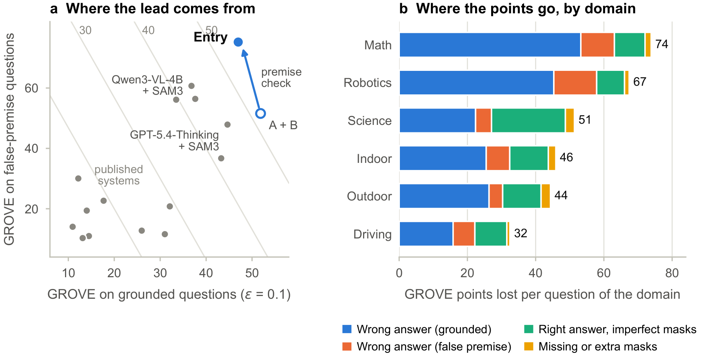
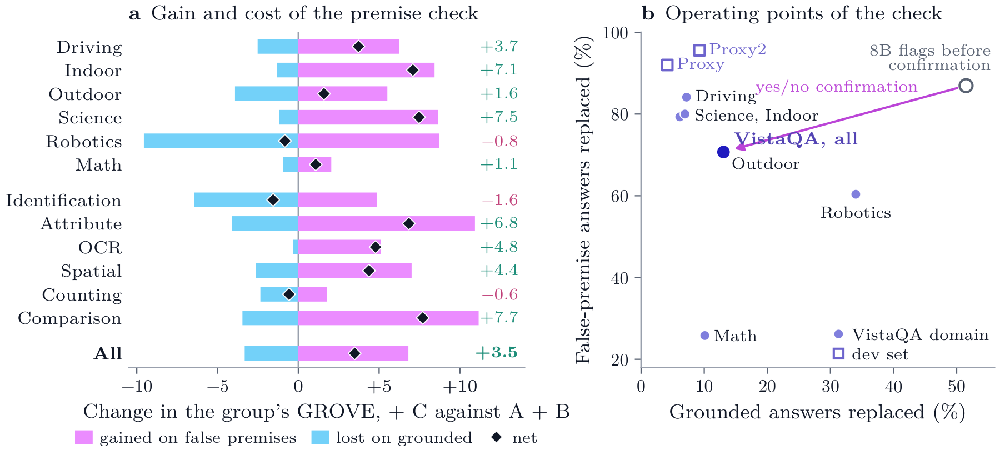
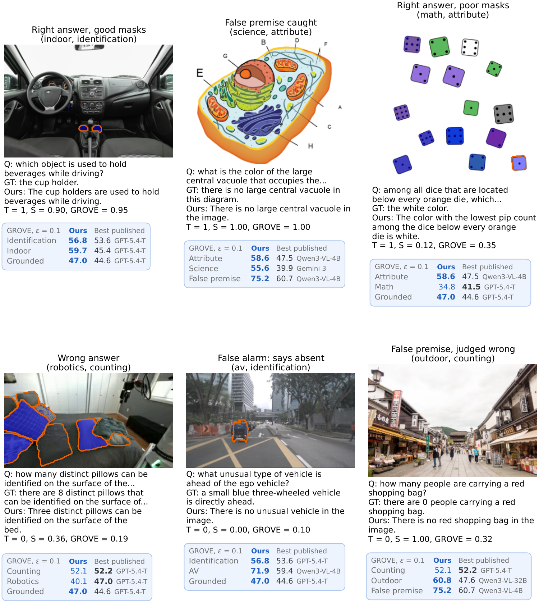
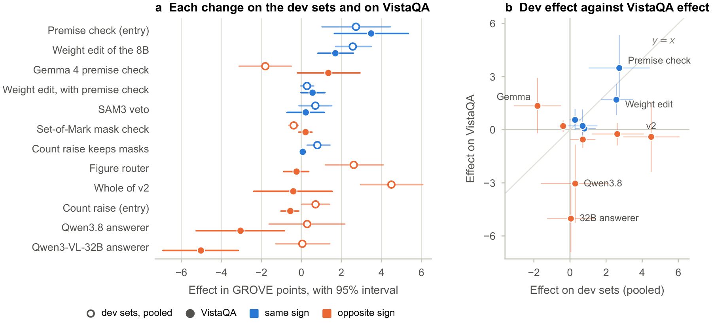

<div align="center">

# Grounding the Ungroundable

### Answers, Masks, and Absences in Zero-Shot VQA

<a href="https://vlm4rwd.github.io/"></a>
<a href="https://vlm4rwd.github.io/challenges.html"></a>
<a href="https://huggingface.co/datasets/mozhina/VistaQA"></a>
<a href="#how-the-system-works"></a>
<a href="#results-at-a-glance"></a>
<a href="LICENSE"></a>
<a href="https://hits.sh/github.com/farhanishraq17/vistaqa-zero-shot-grounding/"></a>

</div>

This repository contains the code, configurations, run log, predictions, and official evaluation outputs for “Grounding the Ungroundable: Answers, Masks, and Absences in Zero-Shot VQA,” the system report of Team_BakeNekos's entry to Track 1 of the [VistaQA Zero-Shot Grounding Challenge](https://vlm4rwd.github.io/challenges.html), held with the 2nd Workshop on Grounded and Faithful Vision-Language Models for Real-World Deployment ([VLM4RWD](https://vlm4rwd.github.io/)) at NeurIPS 2026.

> **For verification.** The entry's predictions, in the official format with full-resolution COCO RLE masks, are in [`runs/final/preds.jsonl`](runs/final/preds.jsonl). Their official evaluation is in [`runs/final/evaluation_results.json`](runs/final/evaluation_results.json), with per-sample scores in [`runs/final/per_sample.jsonl`](runs/final/per_sample.jsonl) and the judge's verdicts in [`runs/final/judge_out/verdicts.jsonl`](runs/final/judge_out/verdicts.jsonl). The same predictions under the unquantized judge are in [`runs/final-fulljudge/`](runs/final-fulljudge/). [Verify the entry](#verify-the-entry) recomputes the headline numbers from these files without a GPU.

## Overview

A deployable vision-language system should answer a question about an image, ground the answer in pixels, and recognize when the object asked about is absent. [VistaQA](https://arxiv.org/abs/2605.20676) tests all three: it asks a model to answer and to segment every instance of its evidence, yet 27% of its 1,157 questions rest on a false premise. The strongest published systems pair one vision-language model (VLM) with SAM3 and trust that model alone to notice a false premise.

Our system is a training-free chain of open-weight models that separates three jobs. **Qwen3.6-27B** answers and boxes its evidence, **SAM3** turns the boxes into masks, and a separate **Qwen3-VL-8B** pass, which never sees the answer, checks whether the premise is visible at all. A guarded rule then raises under-counted answers. Every design choice was made on external proxy data, and the configuration was registered before VistaQA was first scored. The entry scores **54.65 GROVE** against **45.53** for the best published system, GPT-5.4-Thinking + SAM3, mostly through false-premise questions (**75.2** against **47.9**). These scores use the benchmark paper's ε = 0.1; at the evaluation code's default ε = 0.01, the entry scores **48.40** against **35.86**.

<p align="center">
  <a href="images/pipeline.png">
    
  </a>
  <br>
  <sub><strong>The zero-shot pipeline.</strong> Only the image and the question are read. (A) Qwen3.6-27B answers and boxes its evidence, (B) SAM3 turns each box into a mask, (C) Qwen3-VL-8B, blind to the answer, names anything the question assumes but the image lacks and confirms it with a yes/no question, and (D) on plain counting questions, SAM3 and the 8B may raise an under-counted answer. Three merge rules turn the passes into an answer with masks, or a stated absence with none. The image and the counting question <em>q</em><sub>1</sub> are VistaQA sample 811 (CC BY 4.0), shown with the entry's saved answer and masks; <em>q</em><sub>2</sub> and its outputs are illustrative. From the paper.</sub>
</p>

## Contents

- [Key findings](#key-findings)
- [How the system works](#how-the-system-works)
- [Benchmark and zero-shot protocol](#benchmark-and-zero-shot-protocol)
- [Results at a glance](#results-at-a-glance)
- [Analyses beyond the entry](#analyses-beyond-the-entry)
- [Repository guide](#repository-guide)
- [Using this repository](#using-this-repository)
- [Scope and interpretation](#scope-and-interpretation)
- [Authors](#authors)
- [Citation](#citation)
- [License](#license)

## Key findings

| Finding | Evidence from the paper |
|:---|:---|
| **The entry leads the published board.** | **54.65** GROVE (95% interval 52.5–56.8) against **45.53** for GPT-5.4-Thinking + SAM3, the best of 14 published systems, and **48.40** against **35.86** at ε = 0.01. The unquantized judge gives **54.43**. The entry leads **11 of the 14** task, question-type, and domain columns, is level on counting, and trails GPT-5.4-Thinking on math and robotics. Published per-sample outputs are unreleased, so no comparison is paired. |
| **Most of the margin comes from questions about absent objects.** | On false-premise questions, the entry scores **75.2** against **47.9** for GPT-5.4-Thinking + SAM3. Their text accuracy is level overall (**60.76** against **61.02**) but differently composed: **72.0%** against **39.2%** on false-premise questions and **56.6%** against **69.2%** on grounded ones. Our masks are better (mIoU **52.05** against **41.98**). |
| **Checking the premise apart from the answer is the stage that pays.** | The premise check adds **+3.49** GROVE on VistaQA (95% CI +1.65 to +5.35) and **+7.20** on the proxy, the only stage whose gain held on both. It caught **222 of 314** false premises but also fired on **110 of 843** grounded questions (13%, against 4% on the proxy), at a cost of **4.6** points on grounded questions. |
| **The count raise did not transfer.** | Chosen for **+1.54** on the proxy, it lost **0.55** on VistaQA (95% CI −1.02 to −0.13): of 23 raised answers, **10** turned wrong and **2** turned right. The entry keeps it, as registered. |
| **A proxy gain only partly predicts a VistaQA gain.** | The dev sets gave the right sign for **5 of 12** changes. Only the premise check and a weight edit of the 8B, both aimed at false premises, have intervals above zero on both sides. The largest dev gains, the whole of v2 (**+4.50** pooled) and a figure router (**+2.62**), came to nothing on VistaQA, and the Qwen3-VL-32B answerer's level dev result (**+0.05**) hid a **−5.02** loss. |
| **Newer backbones, thinking, a calculator, and larger inputs did not beat the entry.** | Four later systems, each chosen on dev sets and registered before its single VistaQA run, scored **48.01–48.37** against the entry's **48.40**, and neither judge build separates any of them from the entry. |
| **Most lost points are wrong answers, not masks.** | Of the **51.6** points lost at ε = 0.01, **30.4** come from wrong answers to grounded questions, **11.9** from imperfect masks on right ones, **7.3** from wrong false-premise answers, and **1.9** from missing or extra masks. Of 460 right grounded answers with masks, **169** carry more masks than the ground truth, against 1 of 310 on the proxy. |

Differences are in GROVE points, with paired-bootstrap 95% intervals over questions (10,000 resamples). Scores use the AWQ judge and ε = 0.01 unless they are compared with the published board, which uses ε = 0.1.

## How the system works

Given an image *x* and a question *q*, the system returns a free-form answer *a* and a set *M* of instance masks of its evidence. Under a false premise, *a* must state the absence and *M* must be empty. Each stage runs as its own pass, and fixed rules merge them:

| Stage | Model | What it does |
|:---|:---|:---|
| **A**: answer and evidence boxes | Qwen3.6-27B, 4-bit NF4 | One prompt returns a one-sentence answer and one labeled box per evidence instance, with no boxes if the object is absent. The judge rejects bare answers, so answers of at most three words are rewritten into a sentence. |
| **B**: masks from boxes | SAM3, tracker head | Each box of A prompts one full-resolution mask. |
| **C**: premise check, blind to the answer | Qwen3-VL-8B, fp16 | Told not to answer, the 8B names any object, person, text, or detail *X* that the question assumes and the image lacks. A POPE-style question, “Is there any *X* in the image?”, confirms it. |
| **D**: count raise | SAM3, text prompt; Qwen3-VL-8B | On plain counting questions (at most 12 words, no arithmetic), SAM3 counts A's evidence label at score ≥ 0.8, and the 8B answers the counting question itself. |

1. A's answer takes B's masks, one per box.
2. If C's yes/no question confirms that *X* is absent, the output becomes “There is no *X* in the image.” with no masks.
3. On plain counting questions, if the larger of the SAM3 and 8B counts exceeds A's, it replaces A's count, and the winning counter's masks replace A's.

The prompts are in [`src/pipeline.py`](src/pipeline.py). Each pass's exact configuration is in its `runs/<pass>/manifest.json` and in the FINAL section of [`EXPERIMENTS.md`](EXPERIMENTS.md).

### Every choice was made on external data

| Choice | Measured on the proxy development set and probes | Outcome |
|:---|:---|:---|
| Answerer | One pass with SAM2.1-L: Qwen3-VL-4B 39.02, Qwen3-VL-8B 58.60, Qwen3.5-9B 62.14, Qwen3.6-27B **64.91** GROVE | Qwen3.6-27B |
| Short-answer rewrite | Qwen3-VL-8B 58.60 → **62.31**; the 27B chain 71.74 → **72.29** | Kept |
| Segmenter | On the same boxes, SAM2.1-L 71.74 and SAM3 71.72 | SAM3, which the count raise also uses |
| Premise checker | The 8B with confirmation catches **138 of 150** false premises with **17 of 410** false alarms; the 27B's own check, 135 and 36 | The 8B with confirmation |
| Count raise | SAM3 alone at τ = 0.7: 73.04; all three counters at τ = 0.8: **73.81** | Kept |
| Count guard | MathVista count probe, exact counts of 168: guarded **115**, unguarded 108, no raise 114 | Guard kept |
| Thinking in the 27B | 73.64 against 73.81, at three times the inference time | Dropped |
| OCR zoom re-read | One net sample on the proxy; OCR-probe text accuracy 76.44 → 75.11 | Dropped |

## Benchmark and zero-shot protocol

### VistaQA and GROVE

VistaQA (v1.1, [`mozhina/VistaQA`](https://huggingface.co/datasets/mozhina/VistaQA)) has 1,157 questions over six tasks (identification, attribute, OCR, spatial, counting, comparison) and six domains (driving, indoor, outdoor, science, robotics, math). Of these questions, 314 (27%) rest on a false premise. GROVE scores a system π on *N* samples as

$$
G(\pi) = \frac{100}{N} \sum_{i=1}^{N} \sqrt{\max(T_i, \epsilon)\, \max(S_i, \epsilon)}
$$

where *T*<sub>*i*</sub> ∈ {0, 1} is an LLM judge's verdict on answer *i* and *S*<sub>*i*</sub> is the sum of Hungarian-matched IoUs between the predicted and ground-truth masks, divided by the larger of the two mask counts. At ε = 0.1, a wrong answer therefore scores at most 0.32, while a correctly stated absence with no masks scores the full 1.0.

The VistaQA paper reports ε = 0.1, and the [official evaluation code](https://github.com/VistaQA/VistaQA-Evaluation) defaults to ε = 0.01, which every `evaluation_results.json` here and every score in [`EXPERIMENTS.md`](EXPERIMENTS.md) uses. The benchmark's judge is Qwen2.5-14B-Instruct. The entry's registered score uses its AWQ build; the unquantized model judged the same predictions too, and both judges were committed to before either ran.

### Zero-shot protocol

- **VistaQA was used for final evaluation only.** No VistaQA sample, label, or mask informed any design decision, and at inference each pass reads only the image and the question.
- **The entry was registered before VistaQA was first scored.** The frozen configuration (73.81 on the proxy) was committed before VistaQA evaluation, and its predictions before judging; see the FINAL section of [`EXPERIMENTS.md`](EXPERIMENTS.md). The only later change was a formatting fix, made before scoring: three masks were resized to the declared size of two VistaQA images whose files are smaller than their metadata says.
- **The harness was checked before any system was scored.** The ground truth, submitted as a prediction, scores 100.00. Moving each answer to the next sample gives 1.21% text accuracy and a GROVE of 11.09, as the formula predicts.
- **Every later VistaQA run is analysis.** Each was registered in [`EXPERIMENTS.md`](EXPERIMENTS.md) before its single VistaQA run, and none replaces the entry. No VistaQA sample was inspected individually for development; the later systems were prompted by the entry's aggregate scores only. The six qualitative panels below were drawn after development closed, by a seeded rule registered before any sample was viewed. Any further image inspection, including choosing the image in the pipeline figure, was for post-development illustration only and did not inform the system.

Commit hashes cited in [`EXPERIMENTS.md`](EXPERIMENTS.md) refer to our private development repository. Its history holds account details, so this public copy starts a fresh history; we can show the original commits to the organizers on request.

### Development data

No number in this table comes from VistaQA. The proxy development set and the premise, count, and OCR probes decided the entry, and their builders are included. The other sets came after the entry was scored and served only the analyses; their builders are not part of this repository.

| Set | *n* | Source | False premises | Used for | Builder |
|:---|---:|:---|---:|:---|:---|
| Proxy development set | 560 | COCO val2017, PACO-LVIS, COCO-Text v2; templated questions, with answers and masks from the annotations | 150 | Every decision of the entry | [`build_proxy_dev.py`](src/build_proxy_dev.py) |
| Premise probe | 300 | MathVista testmini: 200 questions on their own image, 100 moved to another question's image | 100 | Premise false alarms on figures | [`build_premise_probe.py`](src/build_premise_probe.py) |
| Count probe | 168 | MathVista testmini integer questions that match the count pattern | 0 | The count guard | [`build_count_probe.py`](src/build_count_probe.py) |
| OCR probe | 225 | TextVQA val reading questions | 0 | OCR zoom; premise false alarms | [`build_ocr_probe.py`](src/build_ocr_probe.py) |
| Proxy2 | 580 | Drawn charts and geometry, BOP (YCB-V, LM-O), 2018 Data Science Bowl, BDD100K | 158 | The later systems v2–v5 | Not included |
| Proxy3 | 200 | RefCOCOg val (UMD split), crowded scenes | 0 | The mask verifier | Not included |
| Math probe | 200 | MathVista testmini | 0 | Thinking and the calculator | Not included |
| V\*Bench probe | 238 | V\*Bench | 0 | Input resolution | Not included |
| Weight-edit practice set | 300 images | COCO val2017 images outside the proxy, each with one absent-object and one present-object question | Half | The weight edit | Not included |

### Models and compute

| Role | Checkpoint | Precision | Revision |
|:---|:---|:---|:---|
| Answerer (A) | `Qwen/Qwen3.6-27B` | 4-bit NF4, fp16 compute | `6a9e13bd6fc8f0983b9b99948120bc37f49c13e9` |
| Premise check (C) and 8B counts (D) | `Qwen/Qwen3-VL-8B-Instruct` | fp16 | `0c351dd01ed87e9c1b53cbc748cba10e6187ff3b` |
| Segmenter (B, D) | `facebook/sam3`, loaded from the Kaggle Models mirror `chonlanawawa/sam3/pyTorch/default/1` (same SHA-256 files) | fp16 | `3c879f39826c281e95690f02c7821c4de09afae7` |
| Judge (registered) | `Qwen/Qwen2.5-14B-Instruct-AWQ` | AWQ | `539535859b135b0244c91f3e59816150c8056698` |
| Judge (cross-check) | `Qwen/Qwen2.5-14B-Instruct` | fp16 | `cf98f3b3bbb457ad9e2bb7baf9a0125b6b88caa8` |
| Data | `mozhina/VistaQA` (dataset, v1.1) | | `cf0cb9857e5f0969a7fc2c8efb3ae9d4816ccc1a` |

The passes load each model by its Hub id, so they get the current `main`. When this release was built, every revision above was still `main` except Qwen3.6-27B's, which gained one commit on 2026-11-07, after our runs. That commit changes only the chat template files, and the prompt our passes render is identical under both. The analyses also use Qwen3.8-27B (v2–v5), Qwen3-VL-32B-Instruct and Gemma 4 31B (model swaps), and, during development, Qwen3-VL-4B, Qwen3.5-9B, and SAM2.1-L.

Nothing is trained or fine-tuned. The entry's five passes ran as Kaggle kernels on two T4 GPUs each (Python 3.13, torch 2.11, transformers 5.16.1) with greedy decoding. They took 17.9 hours of inference in total: about 12 for the answerer and 6 for the other four passes. As a cross-hardware check, we re-ran a 27B answer pass (v2's) and SAM3 on 150 VistaQA samples on an RTX 3090. It reproduced 147 answers byte for byte and 259 masks with a mean IoU of 0.9998.

## Results at a glance

### Against the published board

| System | GROVE, ε = 0.01 | GROVE, ε = 0.1 | Grounded | False premise |
|:---|---:|---:|---:|---:|
| GPT-5.4-Thinking + SAM3 | 35.86 | 45.53 | 44.65 | 47.89 |
| Qwen3-VL-4B + SAM3 | 34.14 | 43.30 | 36.81 | 60.72 |
| Qwen3-VL-32B + SAM3 | 33.51 | 42.72 | 37.63 | 56.41 |
| GPT-5.4 + SAM3 | 31.61 | 41.50 | 43.28 | 36.72 |
| Gemini 3 + SAM3 | 25.49 | 39.63 | 33.48 | 56.14 |
| VRT-RL, the best without SAM3 | 17.93 | 29.02 | 32.09 | 20.79 |
| **Ours, AWQ judge (the entry)** | **48.40** | **54.65** | 46.98 | **75.24** |
| Ours, unquantized judge | 48.14 | 54.43 | **47.86** | 72.05 |

The grounded and false-premise columns use ε = 0.1, and bold marks the best value per column. Published rows are quoted from the VistaQA paper, whose appendix gives the ε = 0.01 scores. The nine published systems without SAM3 score 11.8 to 29.0 at ε = 0.1.

| Category | Ours, AWQ judge | Ours, unquantized judge | Best published | Δ |
|:---|---:|---:|:---|---:|
| Identification | **56.75** | 57.32 | 53.62, GPT-5.4-Thinking | +3.1 |
| Attribute | **58.59** | 59.06 | 47.46, Qwen3-VL-4B | +11.1 |
| OCR | **63.79** | 63.04 | 44.16, GPT-5.4-Thinking | +19.6 |
| Spatial | **48.28** | 47.15 | 38.86, GPT-5.4-Thinking | +9.4 |
| Counting | 52.15 | 50.21 | **52.21**, GPT-5.4-Thinking | −0.1 |
| Comparison | **49.21** | 50.50 | 38.93, GPT-5.4-Thinking | +10.3 |
| Driving (AV) | **71.87** | 72.53 | 59.39, Qwen3-VL-4B | +12.5 |
| Indoor | **59.71** | 59.04 | 45.39, GPT-5.4-Thinking | +14.3 |
| Outdoor | **60.77** | 61.06 | 47.63, Qwen3-VL-32B | +13.1 |
| Science | **55.57** | 55.12 | 39.87, Gemini 3 | +15.7 |
| Robotics | 40.08 | 38.14 | **47.01**, GPT-5.4-Thinking | −6.9 |
| Math | 34.76 | 35.85 | **41.51**, GPT-5.4-Thinking | −6.8 |

All values use ε = 0.1. Δ is the entry (AWQ judge) minus the best published system, and bold marks the higher of those two.

<p align="center">
  <a href="images/entry-at-a-glance.png">
    
  </a>
  <br>
  <sub><strong>Where the lead comes from, and where the points go.</strong> (a) GROVE on grounded against false-premise questions at ε = 0.1, for the 14 published systems and ours; each diagonal joins points of equal overall GROVE, and the arrow is the premise check. Answers and boxes alone (A + B) already lie ahead of GPT-5.4-Thinking + SAM3 on both axes. (b) GROVE points lost per question of each domain at ε = 0.01, split by cause. Math and robotics lose 74 and 67 of 100 points, mostly to wrong answers. From the paper.</sub>
</p>

### What each stage adds

| Stage | Proxy | VistaQA, ε = 0.1 | VistaQA, AWQ judge | VistaQA, unquantized judge | Text accuracy, AWQ judge |
|:---|---:|---:|---:|---:|---:|
| A + B: answer, boxes, masks | 65.07 | 51.78 | 45.46 | 45.85 | 59.55 |
| + C: premise check | 72.27 (+7.20) | **55.11** (+3.33) | **48.95** (+3.49) | **48.62** (+2.77) | **61.45** (+1.90) |
| + D: count raise (the entry) | **73.81** (+1.54) | 54.65 (−0.46) | 48.40 (−0.55) | 48.14 (−0.48) | 60.76 (−0.69) |

The proxy guided every decision. The first two stages were scored on VistaQA after the entry, for analysis only. At ε = 0.1, the premise check gives up 4.2 points on grounded questions to gain 23.6 on false-premise ones. With 27% of the questions resting on a false premise, that trade is worth 3.3 points overall.

<p align="center">
  <a href="images/premise-check.png">
    
  </a>
  <br>
  <sub><strong>The premise check gains on false premises everywhere and pays for it on grounded questions.</strong> (a) Change in each group's GROVE when the check is added to answers and boxes: points gained on false-premise questions, points lost on grounded ones, and the net. The net is negative only for robotics, identification, and counting. (b) The share of false-premise answers the check replaces against its false alarms, per domain. Robotics pays 34% false alarms for 60% of its false premises, and both dev sets overstate the check's recall. From the paper.</sub>
</p>

### Qualitative examples

<p align="center">
  <a href="images/qualitative.png">
    
  </a>
  <br>
  <sub><strong>Six VistaQA samples, one per outcome.</strong> Orange outlines are ground-truth masks, and blue fills are ours. T is the AWQ judge's verdict, S the mask score, and every GROVE value uses ε = 0.1. The boxes set our score on each panel's task, domain, and question type beside the best published system's. The failures include undercounting and a premise false alarm on a small object, and in the last panel, the judge rejects an answer that does reject the false premise. Images: VistaQA (CC BY 4.0). From the paper.</sub>
</p>

## Analyses beyond the entry

None of these systems is the entry, which is unchanged. Each was chosen on dev sets and registered in [`EXPERIMENTS.md`](EXPERIMENTS.md) before its single VistaQA run. Their outputs are not part of this repository, but the run log records each registration and result.

### Four later systems

The entry's VistaQA aggregates prompted four later systems: premise false alarms on 13% of grounded questions, over-masking, and weak math and robotics scores. They were built without viewing any VistaQA sample, and because the proxy development set is COCO-only, they were also chosen on proxy2.

| System | What it adds | Proxy2 | VistaQA, AWQ judge | VistaQA, unquantized judge |
|:---|:---|---:|---:|---:|
| The entry | | 57.43 | **48.40** | **48.14** |
| v2 | Qwen3.8-27B answers; a router that sends charts, tables, and diagrams to a prompt that boxes the answer element; a SAM3 veto on the premise check; the count raise keeps masks | **65.87** | 48.01 | 47.01 |
| v3 | v2 + thinking on questions that a second router calls multi-step | **65.87** | 48.21 | 47.29 |
| v4 | v3 + a calculator tool where thinking ran out of tokens | **65.87** | 48.37 | 47.37 |
| v5 | v4 + a 4.19 MP answerer input on large images | **65.87** | 48.03 | 47.34 |

v2 gained 8.4 points on proxy2 but scored −0.40 against the entry on VistaQA (95% CI −2.38 to +1.55). Its new backbone lost 3.0 points at the answer stage (42.43 against 45.46), and the figure prompt, which gained 2.6 on proxy2's drawn charts, gave nothing.

### Weight edit, mask verifier, and model swaps

| Analysis | Dev sets, pooled | VistaQA |
|:---|---:|---:|
| **Weight edit of the 8B**, single pass | +2.57 [+1.71, +3.50] | **+1.70** [+0.83, +2.60], 38.76 → 40.46 |
| Weight edit, both arms with the premise check | +0.28 [−0.03, +0.62] | +0.56 [−0.02, +1.18], 44.35 → 44.90 |
| **Set-of-Mark mask verifier** (the 27B drops masks it does not list as evidence) | −0.38 [−0.63, −0.15] | +0.21 [−0.13, +0.53], 48.61 |
| **Gemma 4 31B** as the premise checker | −1.80 [−3.11, −0.50] | +1.35 [−0.20, +2.93], 49.76 |
| **Qwen3-VL-32B** as the answerer | +0.05 [−1.27, +1.42] | −5.02 [−6.92, −3.15], 43.38 |

Brackets are paired-bootstrap 95% intervals in GROVE points (AWQ judge, ε = 0.01).

- **Weight edit.** In an exploratory study of weight-space programming, Claude Opus 5.5 read Qwen3-VL-8B's activations and weights and proposed a gradient-free edit, chosen on a COCO practice set only. The edit adds rank-1 updates to the output projections of layers 18–20 and a bias at layer 20. It recovers about 30% of the premise check's VistaQA gain (1.70 of 5.59 points) without a second pass, but adds nothing significant once the check runs. The entry takes its answers from the 27B, so the edit does not alter it.
- **Mask verifier.** The check cut over-masked right answers on VistaQA from 169 to 140, and mIoU rose from 52.05 to 52.50, but its GROVE gain is not significant. It lost on the dev sets, where over-masking is rare (6% of right grounded answers with masks, against 37% on VistaQA).
- **Model swaps.** On VistaQA, the dev-set ranking of the two swaps reversed. The 32B answerer's loss lies mostly in its masks on driving scenes, which suggests a box-coordinate shift at 1600×900 in our 4-bit run rather than a limit of the model.

### Does a proxy gain predict a VistaQA gain?

<p align="center">
  <a href="images/transfer.png">
    
  </a>
  <br>
  <sub><strong>Most dev-set effects did not reappear on VistaQA.</strong> (a) Each change's pooled dev-set effect (hollow marks) and VistaQA effect (filled marks), with 95% intervals, sorted by the VistaQA effect. Indigo marks a change whose two signs agree (✓) and raspberry one whose signs do not (✗); the shaded rows are the entry's two stages. (b) The same pairs as points; a change that transferred lies near the diagonal, in a shaded quadrant where the two signs agree. From the paper.</sub>
</p>

The dev sets gave the right sign for 5 of 12 changes, and the two gains that held both target false premises. We read this as absence carrying over better than appearance. A missing object poses much the same problem on COCO as on VistaQA, whereas a new backbone or prompt meets images that the proxies only approximate.

## Repository guide

| Path | Contents |
|:---|:---|
| [`runs/`](runs/) | The submission, its five passes, and its two earlier stages; see the map below |
| [`src/pipeline.py`](src/pipeline.py) | The whole system in one file: the VLM passes, SAM box and text prompts, the merge rules, and output in the official format. [`Scripts/fleet.py`](Scripts/fleet.py) prepends a `CFG` dict for each pass, and `python src/pipeline.py --selftest` runs its checks locally. It also carries options that the entry does not use |
| [`src/judge_kernel.py`](src/judge_kernel.py) | The LLM judge, with the official VistaQA prompt and parser, run through vLLM's offline interface |
| [`src/build_proxy_dev.py`](src/build_proxy_dev.py), `src/build_*_probe.py` | Builders of the external development data that decided the entry |
| [`Scripts/fleet.py`](Scripts/fleet.py) | Runs a pass on this machine (`LOCAL`), as Kaggle kernels, or on a shared GPU machine, and merges passes (`remask`, `override`, `countfix`, `fit`, `check`, and others) |
| [`Scripts/judge.py`](Scripts/judge.py) | Judging on Kaggle and GROVE scoring with the official evaluation code; `score` reuses the stored verdicts |
| [`Scripts/kgl.py`](Scripts/kgl.py) | Runs the Kaggle CLI as any account listed in a git-ignored `Secrets.env` |
| [`Scripts/boot.py`](Scripts/boot.py) | Paired bootstrap of GROVE differences (10,000 resamples, seed 0) |
| [`Scripts/analyze.py`](Scripts/analyze.py) | Diagnostics for scored dev runs, never run on VistaQA |
| [`Scripts/qual_figure.py`](Scripts/qual_figure.py) | Draws the qualitative figure with its registered seeded rule |
| [`EXPERIMENTS.md`](EXPERIMENTS.md) | The complete run log, with the entry's registration in its FINAL section. It also records development runs and later analysis systems whose outputs are not part of this repository |
| [`images/`](images/) | Five figures from the paper used in this README |

A run folder holds some or all of:
- `preds.jsonl`: predictions in the official format, with full-resolution COCO RLE masks.
- `raw.jsonl`: every raw model reply, with parse status, pixel boxes, and seconds per sample.
- `manifest.json`: the pass's exact configuration and shards.
- `evaluation_results.json`: the official scorer's output.
- `per_sample.jsonl`: per-sample GROVE with the task, domain, and question type.
- `judge.json` and `judge_out/verdicts.jsonl`: the judge model, and its verdict on each answer.

Kaggle account names appear as `K01`…`K19` and Kaggle usernames as `user01`…, and the two shared GPU machines as `PC1` and `PC2`.

### Experiment and artifact map

| Result | Run folders under `runs/` | Value |
|:---|:---|:---|
| The entry, registered score | `final` | 48.40 at ε = 0.01, 54.65 at ε = 0.1 |
| The entry, unquantized judge | `final-fulljudge` | 48.14 and 54.43 |
| Stage A + B | `final-s3`, `final-s3-fulljudge` | 45.46 and 45.85 (AWQ judge: 51.78 at ε = 0.1) |
| Stage + C | `final-pc`, `final-pc-fulljudge` | 48.95 and 48.62 (AWQ judge: 55.11 at ε = 0.1) |
| The entry's five passes | `final-ans` (A), `final-seg` (B), `final-prem` (C), `final-cpt` and `final-cnt` (D) | Merged into `final`; see [Rebuild the submission from the pass outputs](#rebuild-the-submission-from-the-pass-outputs) |
| Development runs, later systems, weight edit, mask verifier, model swaps | Not included | Logged in [`EXPERIMENTS.md`](EXPERIMENTS.md) |

## Using this repository

### Verify the entry

No GPU, model, or VistaQA download is needed to check the reported scores. Clone the repository:

```bash
git clone https://github.com/farhanishraq17/vistaqa-zero-shot-grounding.git
cd vistaqa-zero-shot-grounding
```

`runs/final/per_sample.jsonl` stores each sample's GROVE at ε = 0.01. Because GROVE floors the verdict and the mask score alike, each value converts exactly to ε = 0.1:

```python
import json
import math

rows = [json.loads(line) for line in open("runs/final/per_sample.jsonl", encoding="utf-8")]


def at_eps_01(g):
    """Rescore one sample's GROVE from ε = 0.01 to ε = 0.1. A right answer gives g = sqrt(max(S, 0.01)) >= 0.1,
    a wrong one g = 0.1 * sqrt(max(S, 0.01)) <= 0.1, and both readings agree at g = 0.1."""
    if g >= 0.1:
        return math.sqrt(max(g * g, 0.1))
    return math.sqrt(0.1 * max(100 * g * g, 0.1))


print(f"{100 * sum(r['standard_average'] for r in rows) / len(rows):.2f}")             # 48.40 at ε = 0.01
print(f"{100 * sum(at_eps_01(r['standard_average']) for r in rows) / len(rows):.2f}")  # 54.65 at ε = 0.1
```

Replace `final` with `final-fulljudge`, `final-s3`, or `final-pc` to get 54.43, 51.78, and 55.11 at ε = 0.1.

The paired intervals come from [`Scripts/boot.py`](Scripts/boot.py), which needs only NumPy. Each pair of arguments is compared as A minus B:

```bash
python Scripts/boot.py final-pc final-s3 final final-pc final-fulljudge final
# final-pc - final-s3: +3.49 (95% CI +1.65 to +5.35)
# final - final-pc: -0.55 (95% CI -1.02 to -0.13)
# final-fulljudge - final: -0.26 (95% CI -1.16 to +0.63)
```

### Set up

The remaining steps need Python 3.10 or newer, VistaQA, and the official evaluation code, which go in the git-ignored `Competition Data/` folder:

```bash
pip install numpy scipy pillow pycocotools huggingface_hub
python -c "from huggingface_hub import snapshot_download as s; s('mozhina/VistaQA', repo_type='dataset', revision='cf0cb9857e5f0969a7fc2c8efb3ae9d4816ccc1a', local_dir='Competition Data')"
git clone https://github.com/VistaQA/VistaQA-Evaluation "Competition Data/VistaQA-Evaluation"
python src/pipeline.py --selftest   # prints "selftest ok"
```

The second line downloads VistaQA v1.1, the ground truth and images, to `Competition Data/VistaQA` at the revision the entry used.

### Score the submission with the stored verdicts

This step needs no GPU and no account:

```bash
python Scripts/judge.py score final             # GROVE 48.40 | text acc 60.76 | mIoU 52.05 | n=1157
python Scripts/judge.py score final-fulljudge   # GROVE 48.14 | text acc 60.59 | mIoU 52.05 | n=1157
```

It scores [`runs/final/preds.jsonl`](runs/final/preds.jsonl) against the VistaQA ground truth with the official mask scorer and aggregation, reusing the judge's stored verdicts (one 0 or 1 per question in `judge_out/verdicts.jsonl`), and prints the per-task and per-domain scores after a few minutes.

To judge the answers again from scratch, serve the judge and run the official evaluation (one GPU with about 16 GB):

```bash
pip install vllm openai
python -m vllm.entrypoints.openai.api_server --model Qwen/Qwen2.5-14B-Instruct-AWQ --served-model-name judge --port 8001 --max-model-len 4096 &
export OPENAI_API_KEY=EMPTY OPENAI_BASE_URL=http://127.0.0.1:8001/v1
python "Competition Data/VistaQA-Evaluation/src/main.py" --gt "Competition Data/VistaQA" --pred runs/final/preds.jsonl --llm_model judge --epsilon 0.01 --output_dir outputs
```

The result goes to `outputs/evaluation_results.json`; use `--epsilon 0.1` for the benchmark paper's setting. Our reported scores used the same official prompt, parser, mask scorer, and aggregation, with the judge run through vLLM's offline interface ([`src/judge_kernel.py`](src/judge_kernel.py)) instead of a server. Fresh verdicts can differ slightly from the stored ones: the same judge build gave 3 of 802 identical answers a different verdict across runs.

### Rebuild the submission from the pass outputs

Every pass's raw output is in `runs/`, so the merge that produces the submitted predictions re-runs on a laptop:

```bash
python Scripts/fleet.py fit      final-seg --inline "Competition Data/VistaQA"
python Scripts/fleet.py fit      final-cpt --inline "Competition Data/VistaQA"
python Scripts/fleet.py remask   final-s3  --parts final-ans final-seg
python Scripts/fleet.py override final-pc  --parts final-s3 final-prem --confirm
python Scripts/fleet.py countfix final     --parts final-pc final-cpt final-cnt --tau 0.8
python Scripts/fleet.py check    final     --inline "Competition Data/VistaQA"
git status --short runs/
```

`check` prints `1157 preds | unique 1157 | missing 0 | unknown 0 | bad masks 0 | ...`, and `git status` prints nothing: the rebuilt files are identical to the committed ones, including `runs/final/preds.jsonl` (SHA-256 as stored, with LF line endings: `ebeaa1937f83d5a16cc7b7d35ce2fecfed42b29902dee8e13180a7fcf8fd790f`). On Windows, this relies on Git's default `core.autocrlf=true`. `fit` and `check` read only each sample's image id, width, and height.

### Run the system yourself

This needs Linux with two GPUs of 15 GB, or one of 24 GB with `"max_memory": ["21GiB"]` in the first command. The answerer takes about 12 hours on two T4s, and the other passes about 6 hours together. Add `"limit": 20` to a `--cfg` to try a pass on 20 questions first.

```bash
pip install torch transformers==5.16.1 accelerate bitsandbytes kagglehub
python Scripts/fleet.py push final-ans  --accounts LOCAL --cfg '{"vlm": "Qwen/Qwen3.6-27B", "quant": "nf4", "pip": ["bitsandbytes"], "max_memory": ["14GiB", "14GiB"], "seg": "", "expand_short": true}'
python Scripts/fleet.py collect final-ans
python Scripts/fleet.py push final-prem --accounts LOCAL --cfg '{"vlm": "Qwen/Qwen3-VL-8B-Instruct", "premise": "only"}'
python Scripts/fleet.py collect final-prem
python Scripts/fleet.py push final-cnt  --accounts LOCAL --cfg '{"vlm": "Qwen/Qwen3-VL-8B-Instruct", "seg": "", "expand_short": true, "plain_only": true}'
python Scripts/fleet.py collect final-cnt
python Scripts/fleet.py push final-seg  --accounts LOCAL --boxes final-ans    --cfg '{"seg": "kaggle:chonlanawawa/sam3/pyTorch/default"}'
python Scripts/fleet.py collect final-seg
python Scripts/fleet.py push final-cpt  --accounts LOCAL --concepts final-ans --cfg '{"seg": "kaggle:chonlanawawa/sam3/pyTorch/default"}'
python Scripts/fleet.py collect final-cpt
```

These are the entry's frozen configurations. Each `push` runs one pass on this machine and downloads VistaQA and the weights itself. `collect` writes the pass's `runs/<pass>/preds.jsonl` and `raw.jsonl`, replacing ours, so `git diff` compares your run with ours. Then merge with the commands in [Rebuild the submission from the pass outputs](#rebuild-the-submission-from-the-pass-outputs), and judge the new answers with the official evaluation above; the stored verdicts belong to our answers, so `judge.py score` does not apply to a re-run.

`LOCAL` runs the same generated script that a Kaggle kernel runs; we tested this launcher without the models. With Kaggle credentials in a git-ignored `Secrets.env` (`KAGGLE_USERNAME_ME=...`, `KAGGLE_API_TOKEN_ME=...`), `--accounts ME` runs a pass as a Kaggle kernel instead, and `python Scripts/fleet.py status <pass>` shows its progress.

### Rebuild the development data

The four builders are deterministic, list their sources in their docstrings, and write their sets in VistaQA's JSON format under `Competition Data/`. The probes download MathVista and TextVQA from Hugging Face and also need `pyarrow`. The proxy development set needs COCO val2017 instances at `Competition Data/external/annotations/instances_val2017.json`, plus PACO-LVIS val (`paco_lvis_v1_val.json`) and COCO-Text v2 (`cocotext.v2.json`) in `Competition Data/external/`, and fetches its images from COCO.

```bash
python src/build_premise_probe.py
python src/build_count_probe.py
python src/build_ocr_probe.py
python src/build_proxy_dev.py
```

## Scope and interpretation

- **One registered entry, many analyses.** Only the entry was frozen before VistaQA was first scored. The other 21 systems scored on VistaQA are analyses, several of them prompted by the entry's VistaQA aggregates, and none is corrected for multiple comparisons.
- **Comparisons with published systems are unpaired.** Published per-sample outputs are unreleased, so the margins over the published board come without paired intervals, and the published rows are quoted from the VistaQA paper.
- **The judge is an LLM, in two builds.** The registered score uses the AWQ build of Qwen2.5-14B-Instruct. The unquantized model flips 56 of 1,157 verdicts (−0.26 GROVE, 95% CI −1.16 to +0.63), and one answer that rejects a false premise was judged wrong. The intervals resample questions, so they do not include judge noise.
- **The proxy is easier than VistaQA, and different.** The entry scores lower on VistaQA than on any dev set, on every task and both question types. The COCO-based proxy understated the premise check's false alarms (4% against 13% of grounded questions), showed almost no over-masking, and favored a count raise that lost on VistaQA.
- **Doubt has a price.** The premise check costs 4.6 GROVE points on grounded questions, and in robotics it replaces 34% of grounded answers, for a net loss in that domain.
- **Math and robotics remain open.** They are the entry's weakest domains (26.1 and 32.6 GROVE at ε = 0.01), and GPT-5.4-Thinking + SAM3 leads in both. Robotics images are small (median 320×180), and we did not test upscaling them.
- **A known bug in the frozen entry.** The 8B count pass ran without masks, and the count raise takes the winning counter's masks, so 11 of the 23 raised answers lost theirs. With masks kept (a registered analysis run with the same answers, logged in [`EXPERIMENTS.md`](EXPERIMENTS.md)), the merge scores 48.47. The bug therefore cost 0.07 of the raise's 0.55-point loss, and wrongly raised counts cost the rest. The entry is unchanged.
- **Results depend on hardware and precision.** The 27B runs in 4-bit NF4 and the 8B in fp16 on Kaggle T4 GPUs. Other quantizations or GPUs may give slightly different answers. The Qwen3-VL-32B swap's driving-scene loss looks like a coordinate shift in our 4-bit run, and our registered rules allow re-runs only for infrastructure failures, so we did not re-run it.

## Authors

**Team_BakeNekos**

**Md Farhan Ishraq**<sup>1</sup>, **Didhiti Nahid**<sup>1</sup>, **Md Farhan Ishmam**<sup>1,2</sup>, **Syed Rifat Raiyan**<sup>1</sup>

<sup>1</sup> Islamic University of Technology, Bangladesh<br>
<sup>2</sup> Kahlert School of Computing, The University of Utah, USA

Contact: `rifatraiyan@iut-dhaka.edu`, `farhan.ishmam@utah.edu`.

The code, tooling, and report were written with Claude Opus 5.5 as the coding assistant, under the authors' direction; no pass of the entry calls it.

## Citation

Citation details will be added once the system report is released.

## License

The code, configurations, run log, predictions, and evaluation outputs are released under the [MIT License](LICENSE). The questions, image ids, and task, domain, and question-type labels in the outputs come from VistaQA ([`mozhina/VistaQA`](https://huggingface.co/datasets/mozhina/VistaQA), CC BY 4.0). No VistaQA images, ground-truth answers, or masks are included, except for the six samples in [`images/qualitative.png`](images/qualitative.png) and the image and question of sample 811 in [`images/pipeline.png`](images/pipeline.png), reproduced under that license. Model weights are downloaded at run time and are not included (Qwen: Apache-2.0; SAM3: SAM License).
